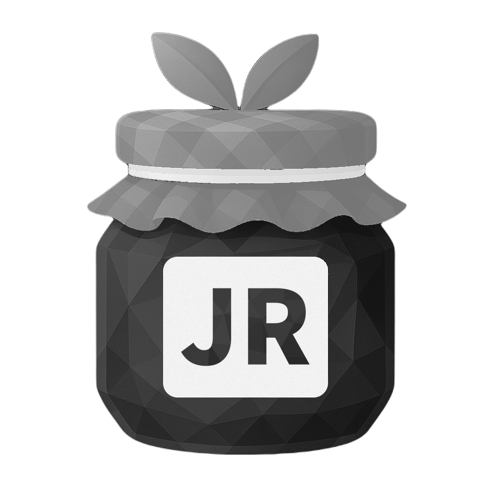

  

<h1 align="center">Jam Reborn has moved to JR</h1>

  Jam Reborn is no longer supported. Everything it did, and a lot more, is now in <b>JR</b>.  
  <a href="https://github.com/BradysLabs/JR/releases/latest"><b>Download JR</b></a> · <a href="https://github.com/BradysLabs/JR">JR on GitHub</a> · <a href="https://discord.gg/UvXzA2gK5W">Join the JR Discord</a>

> [!IMPORTANT]
> Jam Reborn 6.4.0 is the final version. It no longer connects to Animal Jam; opening it only shows where to get JR. This repository is archived and won't be updated.

## How to switch to JR

1. Download **JR-Setup.exe** from the [JR releases page](https://github.com/BradysLabs/JR/releases/latest) and run it.
2. Join the [JR Discord](https://discord.gg/UvXzA2gK5W), then sign in to JR with Discord.
3. Uninstall Jam Reborn from Windows **Settings → Apps**.

## What JR adds

- **Profiles:** each profile opens in its own window, so you can play two accounts at once
- **Trading helper:** values from the Item Worth Wiki in Diamonds, with a favor scale
- **My Shop Templates:** save your shop and refill it in one click or automatically
- **Themes** and a customizable home screen
- **Anti-kick** for idle timeouts, and Discord Rich Presence
- Jam Reborn's plugins, rebuilt for JR. Plugins written for Jam Reborn keep working in JR

## About Jam Reborn

Jam Reborn was a community continuation of Jam, a modular man-in-the-middle proxy for Animal Jam Classic built with Node.js and Electron. It ran from version 5.0.1 to 6.4.0 and added the Plugin Hub, streaming mode, Adventures, Item Previewer, Glow Picker, Name Checker, Masterpiece Studio, Asset Browser, a rebuilt Packet Inspector and more. Thank you to everyone who used it, reported bugs and made plugins.

The source code stays here for reference.

## Legal notice

**No liability.** Jam Reborn was used entirely at your own risk. The authors and contributors are not responsible for any consequences of using it, including account suspensions or bans, lost items or data, or any other damage.

**No warranty.** Jam Reborn is provided "as is", without warranty of any kind, and will not receive further support, updates or fixes.

**Not affiliated.** Jam Reborn is not affiliated with, endorsed by or supported by WildWorks or Animal Jam. Animal Jam and all related game assets, names and trademarks belong to their respective owners.

**License.** Jam Reborn is released under the [MIT License](LICENSE).
